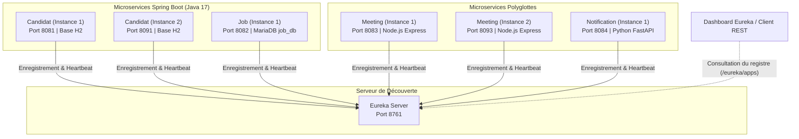

# PROSIT - Architecture Microservices & Netflix Eureka Server

> **Module :** Architecture Web Distribuée  
> **Année Universitaire :** 2026-2027  
> **Institution :** ESPRIT  
> **Projet :** Enregistrement, découverte et multi-instanciation de microservices polyglottes avec Spring Cloud Netflix Eureka

---

## 1. Présentation du projet

Dans le cadre d'une architecture distribuée répondant à des exigences de haute disponibilité et d'élasticité (*scalability*), chaque microservice peut être déployé en plusieurs instances dynamiques. L'utilisation d'adresses IP et de ports codés en dur devient ingérable et vulnérable aux pannes ou aux redémarrages.

Ce projet met en œuvre un **serveur de découverte de services (Service Discovery)** basé sur **Netflix Eureka**. Il permet aux microservices de s'enregistrer automatiquement à leur démarrage (*Service Registration*) et de déclarer leur présence via des signaux réguliers (*heartbeats*), permettant de localiser chaque service par son nom logique (`spring.application.name` ou nom de service VIP).

Le projet illustre une architecture distribuée **polyglotte**, démontrant l'enregistrement et la découverte au sein d'Eureka de microservices développés dans différents écosystèmes :
- **Java 17 / Spring Boot 3.2.5** (`CANDIDAT`, `JOB`)
- **JavaScript / Node.js & Express** (`MEETING`)
- **Python 3 / FastAPI** (`NOTIFICATION`)

---

## 2. Architecture globale

Le schéma ci-dessous illustre le rôle central d'Eureka comme registre d'adresses dynamiques : chaque microservice s'enregistre au démarrage, envoie périodiquement des renouvellements de bail (*heartbeats*), et peut être interrogé pour connaître la topologie active.



---

## 3. Technologies utilisées

Les versions réelles installées et exécutées dans l'environnement du projet sont les suivantes :

| Composant | Langage & Version réelle | Framework & Dépendances clés | Base de données | Port(s) |
| :--- | :--- | :--- | :--- | :--- |
| **Eureka Server** | Java 17 (OpenJDK 17.0.20.1 Temurin) | Spring Boot 3.2.5, Spring Cloud Netflix Eureka Server 4.1.4 | Aucune (registre en mémoire) | `8761` |
| **Candidat** | Java 17 (OpenJDK 17.0.20.1 Temurin) | Spring Boot 3.2.5, Spring Data JPA, Eureka Client 4.1.4, Springdoc 2.5.0 | H2 Database 2.2.224 (in-memory) | `8081`, `8091` |
| **Job** | Java 17 (OpenJDK 17.0.20.1 Temurin) | Spring Boot 3.2.5, Spring Data JPA, Eureka Client 4.1.4, Springdoc 2.5.0 | MariaDB 10.4.32 (XAMPP / port 3306) | `8082` |
| **Meeting** | JavaScript / Node.js v24.16.0 | Express 5.1.0, `eureka-js-client` 4.5.0, `swagger-ui-express` 5.0.1 | Mémoire (Array JavaScript) | `8083`, `8093` |
| **Notification** | Python 3.14.8 | FastAPI 0.165.0, Uvicorn 0.54.0, `py-eureka-client` 0.13.3 | Mémoire (List Python) | `8084` |

---

## 4. Structure des dossiers

```text
codeSource_correctionProsit/
│
├── README.md                               # Documentation technique complète du projet
├── Gateway/                                # API Gateway Spring Cloud (Prosit 3)
│   ├── pom.xml
│   ├── mvnw.cmd / mvnw
│   └── src/main/java/com/example/gateway/
│
├── documentation/
│   ├── Prosit2/                            # Rapport et livrables TP 2 (Observabilité Actuator)
│   ├── Prosit3/                            # Rapport complet et livrables Prosit 3 (API Gateway & Load Balancing)
│   └── screenshots/                        # Emplacement prévu pour les captures d'écran
│
└── codeSource_correctionProsit/
    ├── backend/
    │   └── backend/
    │       └── microservices/
    │           ├── eureka-server/          # Serveur Eureka (Spring Boot)
    │           │   ├── pom.xml
    │           │   ├── mvnw.cmd / mvnw
    │           │   └── src/main/java/com/awd/eureka/EurekaApplication.java
    │           │
    │           ├── gateway/                # API Gateway (Spring Cloud Gateway + Eureka)
    │           │   ├── pom.xml
    │           │   └── src/main/java/com/example/gateway/
    │           │
    │           ├── candidat/               # Microservice Candidat & Adresse (Spring Boot + H2)
    │           │   ├── pom.xml
    │           │   ├── mvnw.cmd / mvnw
    │           │   └── src/main/resources/application.properties
    │           │
    │           ├── job/                    # Microservice Job & Catégorie (Spring Boot + MariaDB)
    │           │   ├── database/job_db.sql # Script SQL d'initialisation de la base
    │           │   ├── pom.xml
    │           │   ├── mvnw.cmd / mvnw
    │           │   └── src/main/resources/application.properties
    │           │
    │           ├── meeting/                # Microservice Réunions (Node.js / Express)
    │           │   ├── package.json
    │           │   ├── src/config/eureka.js# Configuration du client Eureka
    │           │   └── src/server.js       # Serveur Express avec arrêt propre
    │           │
    │           └── notification/           # Microservice Notifications (Python / FastAPI)
    │               ├── requirements.txt
    │               └── app/main.py         # Application FastAPI avec cycle de vie lifespan
    │
    └── documentation/
        ├── diagrams/                       # Diagrammes d'architecture de référence
        └── screenshots/                    # Deuxième dossier pour les captures d'écran
```

---

## 5. Configuration du Serveur Eureka

Le serveur a été créé dans le dossier `codeSource_correctionProsit/backend/backend/microservices/eureka-server`.

### 1. Fichier `pom.xml`
- **Parent :** `spring-boot-starter-parent` en version `3.2.5`
- **BOM Cloud :** `spring-cloud-dependencies` en version `2023.0.4`
- **Dépendance Eureka Server :**
  ```xml
  <dependency>
      <groupId>org.springframework.cloud</groupId>
      <artifactId>spring-cloud-starter-netflix-eureka-server</artifactId>
  </dependency>
  ```

### 2. Classe principale `EurekaApplication.java`
```java
package com.awd.eureka;

import org.springframework.boot.SpringApplication;
import org.springframework.boot.autoconfigure.SpringBootApplication;
import org.springframework.cloud.netflix.eureka.server.EnableEurekaServer;

@SpringBootApplication
@EnableEurekaServer
public class EurekaApplication {
    public static void main(String[] args) {
        SpringApplication.run(EurekaApplication.class, args);
    }
}
```

### 3. Fichier `application.properties`
```properties
spring.application.name=eureka
server.port=8761

# Le serveur Eureka ne doit ni s'enregistrer auprès de lui-même ni mettre en cache son propre registre
eureka.client.register-with-eureka=false
eureka.client.fetch-registry=false
```

---

## 6. Configuration de chaque client Eureka

### 6.1. Microservice CANDIDAT (Spring Boot)
- **Dépendance (`pom.xml`) :** `spring-cloud-starter-netflix-eureka-client`
- **Classe `CandidatApplication.java` :** Annotation `@EnableDiscoveryClient`
- **Configuration (`application.properties`) :**
  ```properties
  spring.application.name=candidat
  server.port=8081
  
  # Enregistrement Eureka
  eureka.client.service-url.defaultZone=http://localhost:8761/eureka
  eureka.client.register-with-eureka=true
  eureka.client.fetch-registry=true
  eureka.instance.prefer-ip-address=true
  ```

### 6.2. Microservice JOB (Spring Boot)
- **Dépendance (`pom.xml`) :** `spring-cloud-starter-netflix-eureka-client`
- **Classe `JobApplication.java` :** Annotation `@EnableDiscoveryClient`
- **Configuration (`application.properties`) :**
  ```properties
  spring.application.name=job
  server.port=8082
  
  # Enregistrement Eureka
  eureka.client.service-url.defaultZone=http://localhost:8761/eureka
  eureka.client.register-with-eureka=true
  eureka.client.fetch-registry=true
  eureka.instance.prefer-ip-address=true
  ```

### 6.3. Microservice MEETING (Node.js / Express)
- **Dépendance (`package.json`) :** `eureka-js-client`
- **Module `src/config/eureka.js` :**
  ```javascript
  const { Eureka } = require('eureka-js-client');

  function getEurekaClient(port) {
    return new Eureka({
      instance: {
        app: 'MEETING',
        instanceId: `localhost:meeting:${port}`,
        hostName: 'localhost',
        ipAddr: '127.0.0.1',
        statusPageUrl: `http://localhost:${port}/swagger-ui`,
        port: { '$': port, '@enabled': 'true' },
        vipAddress: 'MEETING',
        dataCenterInfo: {
          '@class': 'com.netflix.appinfo.InstanceInfo$DefaultDataCenterInfo',
          name: 'MyOwn',
        },
      },
      eureka: {
        host: 'localhost',
        port: 8761,
        servicePath: '/eureka/apps/',
      },
    });
  }
  module.exports = { getEurekaClient };
  ```
- **Cycle de vie (`src/server.js`) :**
  Démarrage via `eurekaClient.start()` et arrêt propre sur signaux `SIGINT`/`SIGTERM` avec `eurekaClient.stop()` pour désenregistrer le service d'Eureka.

### 6.4. Microservice NOTIFICATION (Python / FastAPI)
- **Dépendance (`requirements.txt`) :** `py-eureka-client`
- **Cycle de vie lifespan (`app/main.py`) :**
  ```python
  from contextlib import asynccontextmanager
  import py_eureka_client.eureka_client as eureka_client

  PORT = int(os.getenv("PORT", "8084"))
  EUREKA_SERVER = os.getenv("EUREKA_SERVER", "http://localhost:8761/eureka")

  @asynccontextmanager
  async def lifespan(app: FastAPI):
      # Démarrage : Enregistrement auprès d'Eureka
      await eureka_client.init_async(
          eureka_server=EUREKA_SERVER,
          app_name="NOTIFICATION",
          instance_port=PORT,
          instance_host="localhost",
          instance_id=f"localhost:notification:{PORT}",
          status_page_url=f"http://localhost:{PORT}/swagger-ui",
      )
      yield
      # Arrêt : Désenregistrement propre du registre
      await eureka_client.stop_async()

  app = FastAPI(..., lifespan=lifespan)
  ```

---

## 7. Instructions d'installation et de lancement (PowerShell Windows)

Toutes les commandes ci-dessous sont à exécuter depuis la racine du projet sous **PowerShell Windows** (dans des fenêtres de terminal distinctes).

### Étape 0 : Vérifier MariaDB et importer la base `job_db`
1. Vérifier que le serveur MySQL / MariaDB (ex. XAMPP) écoute sur le port `3306`.
2. Créer la base `job_db` et importer le script SQL initial :
   ```powershell
   & "C:\xampp\mysql\bin\mysql.exe" -u root -e "CREATE DATABASE IF NOT EXISTS job_db;"
   Get-Content .\codeSource_correctionProsit\backend\backend\microservices\job\database\job_db.sql | & "C:\xampp\mysql\bin\mysql.exe" -u root job_db
   ```

---

### Étape 1 : Démarrer le Serveur Eureka (Premier terminal)
```powershell
cd .\codeSource_correctionProsit\backend\backend\microservices\eureka-server
.\mvnw.cmd spring-boot:run
```
> Le Dashboard Web d'Eureka est consultable sur : **`http://localhost:8761`**

---

### Étape 2 : Démarrer les microservices (Instances principales)

#### 1. Candidat - Instance 1 (Port 8081)
```powershell
cd .\codeSource_correctionProsit\backend\backend\microservices\candidat
.\mvnw.cmd spring-boot:run
```

#### 2. Job - Instance 1 (Port 8082)
```powershell
cd .\codeSource_correctionProsit\backend\backend\microservices\job
.\mvnw.cmd spring-boot:run
```

#### 3. Meeting - Instance 1 (Port 8083)
```powershell
cd .\codeSource_correctionProsit\backend\backend\microservices\meeting
npm install
node src/server.js
```

#### 4. Notification - Instance 1 (Port 8084)
```powershell
cd .\codeSource_correctionProsit\backend\backend\microservices\notification
python -m pip install -r requirements.txt
python -m app.main
```

---

### Étape 3 : Commandes pour lancer les deuxièmes instances (Montée en charge)

Ouvrir deux nouveaux terminaux PowerShell :

#### 2ᵉ instance de CANDIDAT (Port 8091) :
> **Note PowerShell :** L'argument `-Dspring-boot.run.arguments=--server.port=8091` doit impérativement être entouré de guillemets pour éviter que PowerShell n'interprète les deux tirets `--` comme un délimiteur d'arguments.
```powershell
cd .\codeSource_correctionProsit\backend\backend\microservices\candidat
.\mvnw.cmd spring-boot:run "-Dspring-boot.run.arguments=--server.port=8091"
```

#### 2ᵉ instance de MEETING (Port 8093) :
```powershell
cd .\codeSource_correctionProsit\backend\backend\microservices\meeting
$env:PORT="8093"; node src/server.js
```

---

## 8. Liste des Endpoints REST & Documentation Swagger

Chaque microservice expose sa documentation OpenAPI et son interface Swagger UI :

| Microservice | Port(s) | Documentation Swagger UI | Endpoints REST principaux |
| :--- | :---: | :--- | :--- |
| **Candidat** | `8081`, `8091` | `http://localhost:8081/swagger-ui.html` | `GET, POST /mic1/candidates`<br>`GET, PUT, DELETE /mic1/candidates/{id}`<br>`GET, POST /mic1/addresses`<br>`PUT /mic1/candidates/{id}/address/{addressId}` |
| **Job** | `8082` | `http://localhost:8082/swagger-ui.html` | `GET, POST /api/jobs`<br>`GET, PUT, DELETE /api/jobs/{id}`<br>`PATCH /api/jobs/{id}/availability`<br>`GET, POST /api/categories` |
| **Meeting** | `8083`, `8093` | `http://localhost:8083/swagger-ui` | `GET /api/meetings/hello` |
| **Notification** | `8084` | `http://localhost:8084/swagger-ui` | `GET /api/notifications/hello` |

---

## 9. Résultats des tests et validation

### 1. Test des Endpoints REST vérifiés
- `GET http://localhost:8081/mic1/candidates` ➔ **Code HTTP 200 OK**
- `GET http://localhost:8091/mic1/candidates` ➔ **Code HTTP 200 OK**
- `GET http://localhost:8082/api/jobs` ➔ **Code HTTP 200 OK** (5 offres chargées depuis MariaDB)
- `GET http://localhost:8083/api/meetings/hello` ➔ `{"message": "hello I'm microservice meeting"}`
- `GET http://localhost:8093/api/meetings/hello` ➔ `{"message": "hello I'm microservice meeting"}`
- `GET http://localhost:8084/api/notifications/hello` ➔ `{"message": "hello I'm microservice notification"}`

### 2. Registre Eureka vérifié (`http://localhost:8761`)
Le registre confirme la présence simultanée de **6 instances actives** au statut **`UP`** :

```text
Application    Instances    Identifiants uniques          Statut
-----------------------------------------------------------------
CANDIDAT       2            localhost:candidat:8081       UP (2)
                            localhost:candidat:8091
JOB            1            localhost:job:8082            UP (1)
MEETING        2            localhost:meeting:8083        UP (2)
                            localhost:meeting:8093
NOTIFICATION   1            localhost:notification:8084   UP (1)
```

---

## 10. Explication technique : Enregistrement, Découverte et Multi-instanciation

Il est essentiel de clarifier ce qui est réalisé dans le cadre de ce PROSIT et de le distinguer des étapes ultérieures d'équilibrage :

### 10.1. Ce qui est réalisé dans ce PROSIT
1. **Service Registration (Enregistrement de service) :**
   - Dès qu'un microservice démarre, son client Eureka envoie une requête HTTP POST au serveur Eureka pour s'enregistrer avec ses métadonnées (IP, port, nom de service, identifiant d'instance).
   - Chaque instance transmet un battement de cœur (*heartbeat*) toutes les 30 secondes pour maintenir son bail actif.
2. **Service Discovery (Découverte de service) :**
   - Eureka maintient en mémoire la liste à jour de toutes les instances en ligne et expose cette liste via son API REST (`/eureka/apps`).
   - Les services et passerelles peuvent ainsi résoudre le nom logique d'un service sans connaître ses adresses physiques à l'avance.
3. **Multi-instanciation (Élasticité) :**
   - L'exécution de plusieurs instances d'un même service (`CANDIDAT` sur 8081 et 8091, `MEETING` sur 8083 et 8093) est supportée grâce à l'attribution d'un `instanceId` unique par port.
   - Les deux instances s'affichent distinctement sous le même nom d'application dans Eureka (`UP (2)`).

### 10.2. Distinction avec le Load Balancing (Équilibrage de charge)
- **Le rôle d'Eureka n'est pas d'exécuter l'équilibrage de charge :** Eureka est un **registre de découverte**, pas un proxy inverse ni un répartiteur de trafic.
- **Ce que le Service Discovery rend possible (étape ultérieure) :**
  - La présence de plusieurs instances dans Eureka est la **condition préalable** permettant à un composant client (comme *Spring Cloud LoadBalancer*, *OpenFeign* ou *Spring Cloud Gateway*) de récupérer la liste des adresses disponibles et d'y appliquer un algorithme de distribution (ex. Round-Robin).
  - Dans le cadre strict de ce PROSIT, l'enregistrement, la découverte et la multi-instanciation sont pleinement validés, mais aucun routage Round-Robin n'est exécuté entre microservices.

---

## 11. Emplacements prévus pour les captures d'écran

Pour compléter le rendu du PROSIT (CC / Rapport), déposer les trois captures d'écran dans le dossier `documentation/screenshots/` :

1. **Dashboard Eureka avec tous les services (4 services enregistrés) :**
   - **Fichier attendu :** `documentation/screenshots/1-eureka-dashboard-all-services.png`
   - **Description :** Vue de `http://localhost:8761` affichant les 4 services `CANDIDAT`, `JOB`, `MEETING` et `NOTIFICATION` au statut `UP`.

2. **Dashboard Eureka avec la multi-instanciation (6 instances actives) :**
   - **Fichier attendu :** `documentation/screenshots/2-eureka-dashboard-multi-instances.png`
   - **Description :** Vue du tableau de bord affichant explicitement `CANDIDAT (2)` (ports 8081 et 8091) et `MEETING (2)` (ports 8083 et 8093).

3. **Validation des endpoints polyglottes :**
   - **Fichier attendu :** `documentation/screenshots/3-polyglot-endpoints-test.png`
   - **Description :** Résultats des requêtes HTTP vers `http://localhost:8083/api/meetings/hello` et `http://localhost:8084/api/notifications/hello`.

---

## 12. Membres de l'équipe

- **Étudiant(s) :** `[À compléter : Nom, Prénom, Identifiant]`
- **Classe / Groupe :** `[À compléter : Ex. 4SIM2 / 3A]`
- **Dépôt GitHub :** `[À compléter : URL du dépôt GitHub du projet]`
