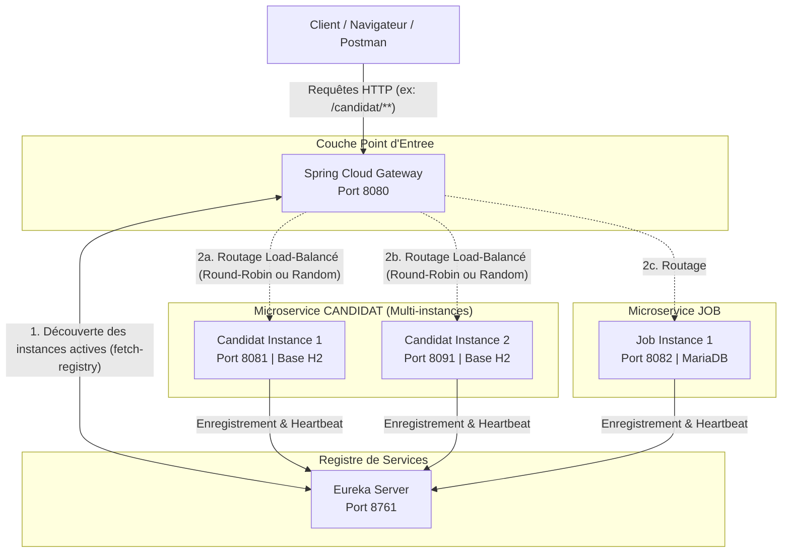

# PROSIT 3 - Implémentation d'une API Gateway avec Spring Cloud Gateway et Eureka

> **Module :** Applications Web Distribuées  
> **Année Universitaire :** 2025-2026 / 2026-2027  
> **Institution :** ESPRIT  
> **Sujet :** Conception, configuration et routage dynamique avec équilibrage de charge (Load Balancing) via Spring Cloud Gateway et Netflix Eureka  
> **Rendu exigé :** Réponses détaillées aux questions de la **Partie 3 (Questions 2.b et 3)**

---

## Sommaire

1. [Objectifs et Rôle d'une API Gateway](#1-objectifs-et-rôle-dune-api-gateway)
2. [Architecture Globale du Système](#2-architecture-globale-du-système)
3. [Partie 1 : Création du Projet API Gateway](#3-partie-1--création-du-projet-api-gateway)
4. [Partie 2 : Configuration Statique de l'API Gateway](#4-partie-2--configuration-statique-de-lapi-gateway)
   - [Méthode 1 : Via une classe de configuration Java (RouteLocatorBuilder)](#méthode-1--via-une-classe-de-configuration-java-routelocatorbuilder)
   - [Méthode 2 : Via le fichier application.properties](#méthode-2--via-le-fichier-applicationproperties)
5. [Partie 3 : Configuration Dynamique avec Eureka](#5-partie-3--configuration-dynamique-avec-eureka)
   - [Méthode 1 : Via une classe de configuration Java (lb://)](#méthode-1--via-une-classe-de-configuration-java-lb)
   - [Méthode 2 : Via application.properties (lb://)](#méthode-2--via-applicationproperties-lb)
   - [Activation des logs de routage](#activation-des-logs-de-routage)
6. [Rendu - Question 2.b : Identification de l'Algorithme de Load Balancing](#6-rendu---question-2b--identification-de-lalgorithme-de-load-balancing)
7. [Rendu - Question 3 : Étude des Algorithmes et Configuration du Random Load Balancer](#7-rendu---question-3--étude-des-algorithmes-et-configuration-du-random-load-balancer)
   - [3.1 Étude comparative des algorithmes de Load Balancing](#31-étude-comparative-des-algorithmes-de-load-balancing)
   - [3.2 Implémentation de l'algorithme Random appliqué UNIQUEMENT au service Candidat](#32-implémentation-de-lalgorithme-random-appliqué-uniquement-au-service-candidat)
8. [Synthèse Comparative : Approche Statique vs Approche Dynamique](#8-synthèse-comparative--approche-statique-vs-approche-dynamique)
9. [Guide de Test et Validation Pratique](#9-guide-de-test-et-validation-pratique)

---

## 1. Objectifs et Rôle d'une API Gateway

Dans une architecture distribuée à base de microservices, chaque service métier (`Candidat`, `Job`, `Candidature`, etc.) peut disposer de plusieurs instances déployées sur des ports ou des adresses IP différents, et évoluer de façon indépendante.

L'**API Gateway** constitue le **point d'entrée unique (Single Point of Contact)** pour l'ensemble des clients (applications web SPA, applications mobiles, partenaires externes). Ses rôles fondamentaux sont :
- **Routage intelligent :** Redirection transparente des requêtes vers le bon microservice en fonction du chemin (*path*), des en-têtes ou des paramètres de requête.
- **Découplage client-serveur :** Le client externe ne connaît que l'URL publique de la Gateway (ex: `http://localhost:8080`) sans avoir à se soucier de l'emplacement réel ou du nombre d'instances en arrière-plan.
- **Équilibrage de charge (Load Balancing) :** Répartition équitable des requêtes entrantes entre les différentes instances actives et saines d'un même microservice.
- **Résilience et observabilité :** Traçabilité centralisée des flux réseau, filtrage, limitation de débit (*rate limiting*), journalisation et gestion centralisée des erreurs de routage.

---

## 2. Architecture Globale du Système

Le schéma ci-dessous illustre l'interaction entre le client externe, l'API Gateway, le serveur d'enregistrement Eureka et les instances de microservices :



---

## 3. Partie 1 : Création du Projet API Gateway

### Paramètres du projet Spring Boot
- **Nom du projet :** `Gateway`
- **Outil de build :** Maven
- **Groupe :** `com.example`
- **Artefact :** `Gateway`
- **Nom du package :** `com.example.gateway`
- **Version Java :** 17
- **Version Spring Boot :** 3.3.4 (ou 3.2.5) / Spring Cloud 2023.0.4

### Dépendances Maven (`pom.xml`)
Pour assurer le routage réactif non bloquant et la résolution dynamique des services via Eureka, le projet intègre les dépendances suivantes :

```xml
<dependencies>
    <!-- Starter Spring Cloud Gateway (routage réactif basé sur Project Reactor & Netty) -->
    <dependency>
        <groupId>org.springframework.cloud</groupId>
        <artifactId>spring-cloud-starter-gateway</artifactId>
    </dependency>

    <!-- Client Eureka (découverte de services) -->
    <dependency>
        <groupId>org.springframework.cloud</groupId>
        <artifactId>spring-cloud-starter-netflix-eureka-client</artifactId>
    </dependency>

    <!-- Spring Cloud LoadBalancer (nécessaire pour la résolution de schéma lb://) -->
    <dependency>
        <groupId>org.springframework.cloud</groupId>
        <artifactId>spring-cloud-starter-loadbalancer</artifactId>
    </dependency>

    <!-- Spring Boot Actuator (santé et métriques) -->
    <dependency>
        <groupId>org.springframework.boot</groupId>
        <artifactId>spring-boot-starter-actuator</artifactId>
    </dependency>
</dependencies>
```

### Classe principale (`GatewayApplication.java`)
La classe principale active la découverte de services via `@EnableDiscoveryClient` :

```java
package com.example.gateway;

import com.example.gateway.config.CandidatLoadBalancerConfiguration;
import org.springframework.boot.SpringApplication;
import org.springframework.boot.autoconfigure.SpringBootApplication;
import org.springframework.cloud.client.discovery.EnableDiscoveryClient;
import org.springframework.cloud.loadbalancer.annotation.LoadBalancerClient;

@SpringBootApplication
@EnableDiscoveryClient
@LoadBalancerClient(name = "candidat", configuration = CandidatLoadBalancerConfiguration.class)
public class GatewayApplication {

    public static void main(String[] args) {
        SpringApplication.run(GatewayApplication.class, args);
    }
}
```

---

## 4. Partie 2 : Configuration Statique de l'API Gateway

Dans le mode statique, l'API Gateway route directement les requêtes vers une URI physique codée en dur (`http://localhost:8081`, `http://localhost:8082`). Elle n'interroge pas le serveur Eureka pour résoudre l'adresse.

### Méthode 1 : Via une classe de configuration Java (`RouteLocatorBuilder`)

```java
@Bean
public RouteLocator gatewayRoutes(RouteLocatorBuilder builder) {
    return builder.routes()
        .route("Candidat", r -> r.path("/candidats/**")
            .uri("http://localhost:8081"))
        .route("Job", r -> r.path("/jobs/**")
            .uri("http://localhost:8082"))
        .build();
}
```

- **`id` :** Identifiant unique de la route (ex: `"Candidat"`).
- **`path` :** Prédicat de chemin déclenchant la route (ex: `/candidats/**`).
- **`uri` :** Emplacement physique direct du microservice cible.

### Méthode 2 : Via le fichier `application.properties`

```properties
spring.application.name=gateway-static
server.port=8080

# Désactivation d'Eureka pour le fonctionnement autonome statique
eureka.client.register-with-eureka=false
eureka.client.fetch-registry=false

# Route statique pour CANDIDAT
spring.cloud.gateway.routes[0].id=CANDIDAT
spring.cloud.gateway.routes[0].uri=http://localhost:8081
spring.cloud.gateway.routes[0].predicates[0]=Path=/candidats/**

# Route statique pour JOB
spring.cloud.gateway.routes[1].id=JOB
spring.cloud.gateway.routes[1].uri=http://localhost:8082
spring.cloud.gateway.routes[1].predicates[0]=Path=/jobs/**
```

---

## 5. Partie 3 : Configuration Dynamique avec Eureka

En configuration dynamique, l'API Gateway s'enregistre auprès d'Eureka et utilise le préfixe de protocole `lb://<SERVICE-NAME>`. L'adresse IP et le port ne sont plus écrits en dur : la Gateway résout dynamiquement les instances enregistrées et effectue l'équilibrage de charge.

### Méthode 1 : Via une classe de configuration Java (`lb://`)

```java
@Bean
public RouteLocator dynamicGatewayRoutes(RouteLocatorBuilder builder) {
    return builder.routes()
        .route("candidat", r -> r.path("/candidat/**")
            .uri("lb://candidat"))
        .route("job", r -> r.path("/jobs/**")
            .uri("lb://job"))
        .build();
}
```

### Méthode 2 : Via `application.properties` (`lb://`)

```properties
spring.application.name=gateway
server.port=8080

# Connexion à Eureka Server
eureka.client.service-url.defaultZone=http://localhost:8761/eureka/
eureka.client.register-with-eureka=true
eureka.client.fetch-registry=true

# Route dynamique vers le microservice 'candidat' via Eureka
spring.cloud.gateway.routes[0].id=CANDIDAT
spring.cloud.gateway.routes[0].uri=lb://candidat
spring.cloud.gateway.routes[0].predicates[0]=Path=/candidat/**,/candidates/**,/mic1/**

# Route dynamique vers le microservice 'job' via Eureka
spring.cloud.gateway.routes[1].id=JOB
spring.cloud.gateway.routes[1].uri=lb://job
spring.cloud.gateway.routes[1].predicates[0]=Path=/jobs/**,/api/**
```

### Activation des logs de routage

Pour observer en temps réel la sélection des instances par le Load Balancer, on active le niveau `DEBUG` :

```properties
logging.level.org.springframework.cloud.gateway=DEBUG
logging.level.reactor.netty.http.client=DEBUG
logging.level.org.springframework.cloud.loadbalancer=DEBUG
```

---

## 6. Rendu - Question 2.b : Identification de l'Algorithme de Load Balancing

### Énoncé
> **Question 2.b :** *Consulter la partie console et identifier l'algorithme utilisé pour faire le load balancer.*

### Réponse détaillée et analyse

L'algorithme utilisé par défaut par Spring Cloud Gateway et Spring Cloud LoadBalancer est **Round Robin** (Tour de rôle cyclique), matérialisé par la classe **`org.springframework.cloud.loadbalancer.core.RoundRobinLoadBalancer`**.

#### 1. Principe de fonctionnement de l'algorithme Round Robin
1. Le client envoie une série de requêtes HTTP successives vers la Gateway (ex: `GET http://localhost:8080/candidat/...`).
2. La Gateway extrait le nom logique du service depuis l'URI cible (`lb://candidat`).
3. Le composant `ServiceInstanceListSupplier` fournit la liste ordonnée des instances saines enregistrées dans Eureka pour ce service (par exemple `[Instance A (port 8081), Instance B (port 8091)]`).
4. Le `RoundRobinLoadBalancer` incrémente de manière atomique un compteur interne modulo le nombre d'instances disponibles (\( \text{index} = (\text{position} + 1) \pmod N \)) :
   - **Requête n°1 :** sélectionne l'**Instance 1 (port 8081)**
   - **Requête n°2 :** sélectionne l'**Instance 2 (port 8091)**
   - **Requête n°3 :** sélectionne à nouveau l'**Instance 1 (port 8081)**
   - **Requête n°4 :** sélectionne à nouveau l'**Instance 2 (port 8091)**

#### 2. Traces observées dans les logs console
Lorsque le niveau de log est configuré à `DEBUG`, la console de l'API Gateway affiche l'alternance stricte des instances choisies :

```text
DEBUG o.s.c.g.h.RoutePredicateHandlerMapping : Route matched: CANDIDAT
DEBUG o.s.c.l.c.RoundRobinLoadBalancer      : Using RoundRobinLoadBalancer for service: candidat
DEBUG o.s.c.l.c.RoundRobinLoadBalancer      : Selected instance: DefaultServiceInstance[instanceId=candidat:8081, serviceId=candidat, host=localhost, port=8081]
DEBUG r.n.h.c.HttpClientConnect             : [Connect] connecting to [localhost/127.0.0.1:8081]
...
DEBUG o.s.c.g.h.RoutePredicateHandlerMapping : Route matched: CANDIDAT
DEBUG o.s.c.l.c.RoundRobinLoadBalancer      : Using RoundRobinLoadBalancer for service: candidat
DEBUG o.s.c.l.c.RoundRobinLoadBalancer      : Selected instance: DefaultServiceInstance[instanceId=candidat:8091, serviceId=candidat, host=localhost, port=8091]
DEBUG r.n.h.c.HttpClientConnect             : [Connect] connecting to [localhost/127.0.0.1:8091]
```

L'alternance régulière et prévisible `8081 -> 8091 -> 8081 -> 8091` prouve empiriquement l'utilisation de **Round Robin**.

---

## 7. Rendu - Question 3 : Étude des Algorithmes et Configuration du Random Load Balancer

### Énoncé
> **Question 3 :** *Chercher les autres types de load balancing existants puis ajouter la configuration nécessaire pour tester l'algorithme Random en l'appliquant uniquement au service candidat.*

---

### 3.1 Étude comparative des algorithmes de Load Balancing

Dans les architectures microservices et les systèmes distribués, plusieurs stratégies de répartition de charge existent :

| Algorithme | Principe | Avantages | Inconvénients | Cas d'usage typiques |
| :--- | :--- | :--- | :--- | :--- |
| **Round Robin (Défaut)** | Distribution séquentielle et circulaire sur les instances disponibles. | Très simple, équitable si toutes les requêtes et machines sont identiques. | Ne prend pas en compte la charge réelle ni la puissance hétérogène des serveurs. | Environnements homogènes avec requêtes de coût similaire. |
| **Random (Aléatoire)** | Sélection aléatoire d'une instance parmi la liste disponible via un générateur pseudo-aléatoire. | Distribution probabiliste homogène à grande échelle, pas d'état partagé lourd. | Risque de déséquilibre statistique temporaire sur un faible échantillon de requêtes. | Trafic élevé avec grand nombre d'instances équivalentes. |
| **Weighted Round Robin** | Chaque instance possède un poids (*weight*) proportionnel à sa capacité (CPU/RAM). | Idéal pour des serveurs aux performances hétérogènes. | Nécessite un étalonnage manuel ou dynamique des poids. | Grappes de machines de générations ou de tailles différentes. |
| **Least Connections** | La requête est attribuée à l'instance qui possède le moins de connexions actives au moment T. | Évite de surcharger une instance bloquée par des traitements longs. | Nécessite un suivi en temps réel de l'état de chaque instance. | Microservices gérant des requêtes à durées d'exécution très variables. |
| **Least Response Time** | Route vers l'instance ayant le temps de réponse (latence) le plus faible. | Optimise l'expérience utilisateur globale et la rapidité de traitement. | Plus complexe à calculer, sensibilité aux pics temporaires. | Systèmes sensibles à la latence (APIs financières, streaming). |
| **IP Hash / Consistent Hashing (Sticky Sessions)** | L'adresse IP du client (ou un ID de session) est hachée pour toujours désigner la même instance. | Permet de conserver du cache local ou un état de session sans session distribuée. | Si une instance tombe, la session est rompue ; risque de déséquilibre. | Applications avec caches locaux volumineux liés à l'utilisateur. |

---

### 3.2 Implémentation de l'algorithme Random appliqué UNIQUEMENT au service Candidat

Pour appliquer l'algorithme **Random** de manière sélective et exclusive au service `candidat`, Spring Cloud LoadBalancer propose l'annotation **`@LoadBalancerClient`**. 

Cette approche assure une **isolation de configuration** :
- Le service `candidat` utilisera **`RandomLoadBalancer`**.
- Les autres services (ex: `job`, `canditature`, `meeting`, etc.) continuent d'utiliser l'algorithme par défaut **`RoundRobinLoadBalancer`**.

#### Étape 1 : Classe de configuration du Load Balancer pour Candidat

Fichier : `src/main/java/com/example/gateway/config/CandidatLoadBalancerConfiguration.java`

```java
package com.example.gateway.config;

import org.springframework.cloud.client.ServiceInstance;
import org.springframework.cloud.loadbalancer.core.RandomLoadBalancer;
import org.springframework.cloud.loadbalancer.core.ReactorLoadBalancer;
import org.springframework.cloud.loadbalancer.core.ServiceInstanceListSupplier;
import org.springframework.cloud.loadbalancer.support.LoadBalancerClientFactory;
import org.springframework.context.annotation.Bean;
import org.springframework.core.env.Environment;

/**
 * Configuration personnalisée du Load Balancer.
 * Instancie un RandomLoadBalancer en remplacement du RoundRobinLoadBalancer.
 */
public class CandidatLoadBalancerConfiguration {

    @Bean
    public ReactorLoadBalancer<ServiceInstance> randomLoadBalancer(
            Environment environment,
            LoadBalancerClientFactory loadBalancerClientFactory) {
        
        String name = environment.getProperty(LoadBalancerClientFactory.PROPERTY_NAME);
        return new RandomLoadBalancer(
                loadBalancerClientFactory.getLazyProvider(name, ServiceInstanceListSupplier.class),
                name
        );
    }
}
```

> **Remarque importante d'architecture :**  
> Cette classe ne doit **pas** être annotée avec `@Configuration` globale si elle réside dans le scan de composants principal, afin d'éviter qu'elle ne s'applique accidentellement à tous les microservices. Elle est rattachée de manière ciblée par `@LoadBalancerClient`.

#### Étape 2 : Déclaration du LoadBalancerClient ciblé

Fichier : `src/main/java/com/example/gateway/GatewayApplication.java`

```java
package com.example.gateway;

import com.example.gateway.config.CandidatLoadBalancerConfiguration;
import org.springframework.boot.SpringApplication;
import org.springframework.boot.autoconfigure.SpringBootApplication;
import org.springframework.cloud.client.discovery.EnableDiscoveryClient;
import org.springframework.cloud.loadbalancer.annotation.LoadBalancerClient;

@SpringBootApplication
@EnableDiscoveryClient
// Déclare que seul le service logique "candidat" utilise CandidatLoadBalancerConfiguration
@LoadBalancerClient(name = "candidat", configuration = CandidatLoadBalancerConfiguration.class)
public class GatewayApplication {

    public static void main(String[] args) {
        SpringApplication.run(GatewayApplication.class, args);
    }
}
```

#### Étape 3 : Vérification du comportement Random dans la console

Lorsque l'on envoie plusieurs requêtes consécutives vers `http://localhost:8080/candidat/...`, on constate dans la console que les instances ne s'alternent plus de façon prévisible (1-2-1-2) mais de façon aléatoire :

```text
Requête 1 -> Sélection instance candidat:8081  (Random)
Requête 2 -> Sélection instance candidat:8081  (Random a repris 8081)
Requête 3 -> Sélection instance candidat:8091  (Random)
Requête 4 -> Sélection instance candidat:8081  (Random)
Requête 5 -> Sélection instance candidat:8091  (Random)
Requête 6 -> Sélection instance candidat:8091  (Random)
```

Tandis que pour le service `job`, la rotation séquentielle Round-Robin demeure inchangée.

---

## 8. Synthèse Comparative : Approche Statique vs Approche Dynamique

Le tableau ci-dessous synthétise les critères de décision entre la configuration statique et la configuration dynamique :

| Critère | Approche Statique (`http://localhost:PORT`) | Approche Dynamique (`lb://SERVICE-NAME`) |
| :--- | :--- | :--- |
| **Utilisation d'Eureka** | ❌ Non requise | ✅ Indispensable |
| **Connaissance des adresses physiques** | Obligatoire (IP et port codés en dur dans la Gateway) | Inutile (la Gateway résout le nom de service via le registre Eureka) |
| **Équilibrage de charge (Load Balancing)** | ❌ Impossible nativement (la route cible une seule IP/port fixe) | ✅ Natif et transparent (Round Robin, Random, pondéré, etc.) |
| **Scalabilité horizontale (Élasticité)** | Très difficile (nécessite de reconfigurer et redémarrer la Gateway à chaque nouvelle instance) | Immédiate et automatique : toute nouvelle instance s'enregistre et reçoit du trafic |
| **Tolérance aux pannes** | Faible (si le port cible tombe, la route est brisée) | Élevée (Eureka détecte la perte du heartbeat et retire l'instance défaillante) |
| **Temps de démarrage / latence initiale** | Instantané (aucune dépendance réseau initiale) | Léger délai initial dû à la récupération et au rafraîchissement du registre Eureka |
| **Cas d'usage recommandé** | Environnements de test très simples ou redirection vers des APIs tierces externes fixes | Environnements de production microservices, clusters Kubernetes, architectures résilientes |

---

## 9. Guide de Test et Validation Pratique

### Ordre de démarrage recommandé

1. **Serveur Eureka :**
   ```powershell
   cd .\codeSource_correctionProsit\backend\backend\microservices\eureka-server
   mvn spring-boot:run
   ```
   *Vérifier sur l'interface : `http://localhost:8761`*

2. **Microservice Candidat - Instance 1 (Port 8081) :**
   ```powershell
   cd .\codeSource_correctionProsit\backend\backend\microservices\candidat
   mvn spring-boot:run
   ```

3. **Microservice Candidat - Instance 2 (Port 8091 pour tester le Load Balancing) :**
   ```powershell
   cd .\codeSource_correctionProsit\backend\backend\microservices\candidat
   mvn spring-boot:run -Dspring-boot.run.arguments="--server.port=8091"
   ```

4. **API Gateway (Port 8080) :**
   ```powershell
   cd .\Gateway
   mvn spring-boot:run
   ```

### Commandes de test du routage et de l'équilibrage de charge

- **Vérification de l'état de l'API Gateway :**
  ```powershell
  curl -i http://localhost:8080/actuator/health
  ```

- **Envoi de requêtes vers le microservice Candidat à travers la Gateway :**
  ```powershell
  # Appel via la route dynamique configurée
  curl -i http://localhost:8080/mic1/candidates
  curl -i http://localhost:8080/candidat/candidates
  ```

- **Boucle de validation du Load Balancing (PowerShell) :**
  ```powershell
  1..10 | ForEach-Object {
      Write-Host "Requête #$_" -ForegroundColor Cyan
      Invoke-RestMethod -Uri "http://localhost:8080/mic1/candidates" -Method Get | Out-Null
      Start-Sleep -Milliseconds 200
  }
  ```
  *Observer en direct dans la console de la Gateway la sélection des instances `8081` et `8091` confirmant l'algorithme configuré.*
